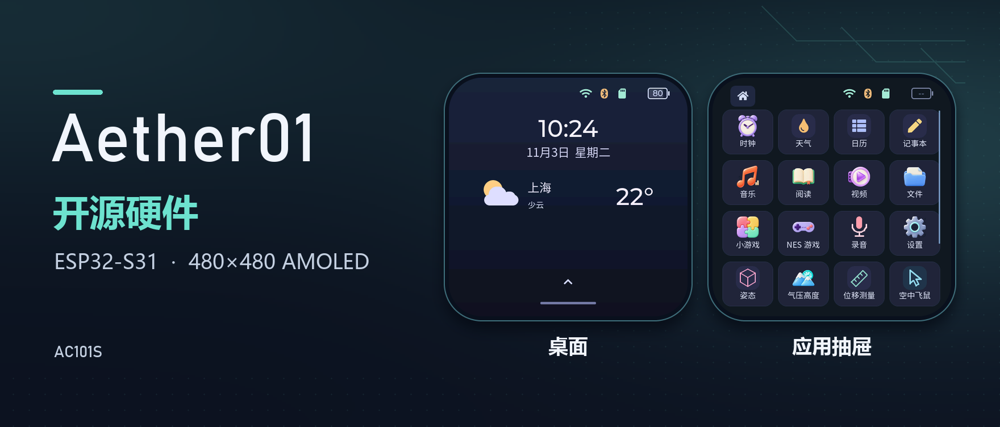

<!-- GitHub profile for DarkThunder (DT-DT001) -->

# DarkThunder

## 以太01 · Aether01

一台基于 ESP32-S31 的掌上设备，配备 480 × 480 AMOLED 触屏和 AC101S 音频芯片。固件集成阅读、音乐、天气和内置游戏。

  

**[硬件设计](https://github.com/DT-DT001/Aether01-Hardware-AC101S)** · **[固件源码](https://github.com/DT-DT001/Aether01-AC101S-)** · **[下载最新固件](https://github.com/DT-DT001/Aether01-AC101S-/releases/latest)**

## 其他嵌入式项目 · Selected projects

<table>
  <tr>
    <td width="50%" valign="top"> 可移植的四色电子纸 C 驱动，包含离线抖动工具。</td>
    <td width="50%" valign="top"> ESP32-S3 USB 转 UART 透传，支持运行时切换波特率。</td>
  </tr>
</table>

## 贡献 · Contributions

<picture>
  <source media="(prefers-color-scheme: dark)" srcset="https://raw.githubusercontent.com/DT-DT001/DT-DT001/output/contribution-snake-dark.svg">
  
</picture>
