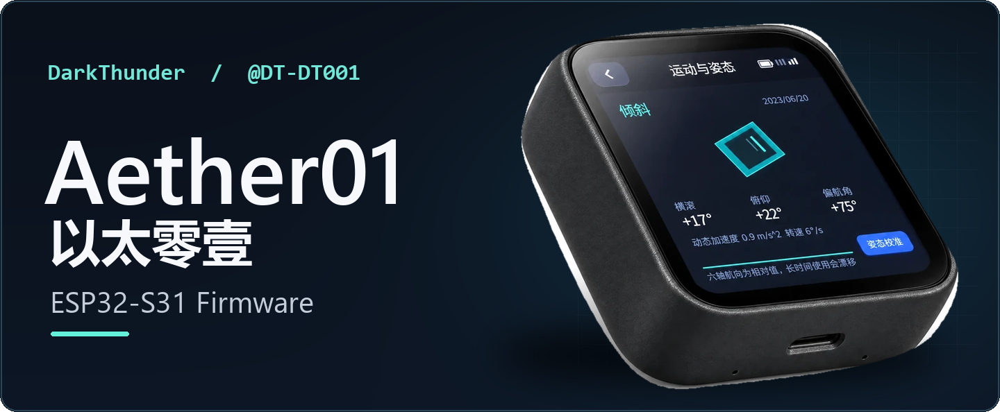

<!-- GitHub profile for DarkThunder (DT-DT001) -->

  

## Selected repositories

  
  

## Contributions

<picture>
  <source media="(prefers-color-scheme: dark)" srcset="https://raw.githubusercontent.com/DT-DT001/DT-DT001/output/contribution-snake-dark.svg">
  
</picture>
